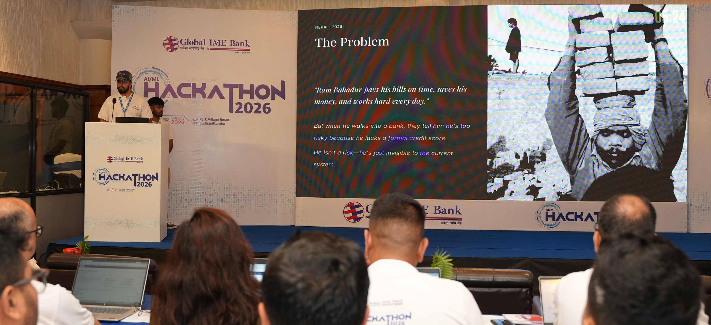
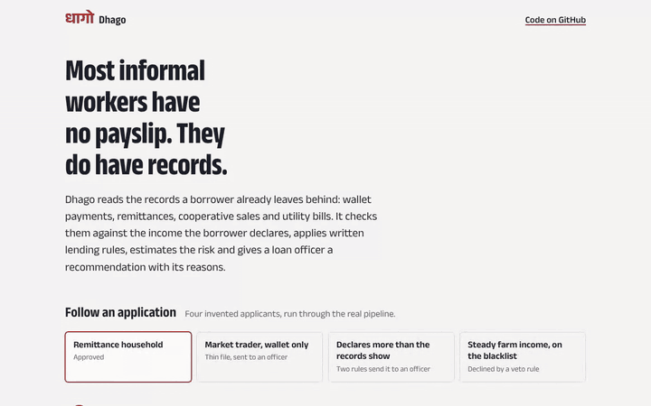
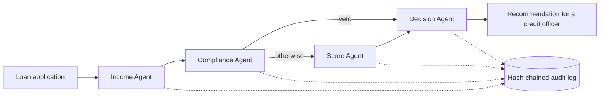
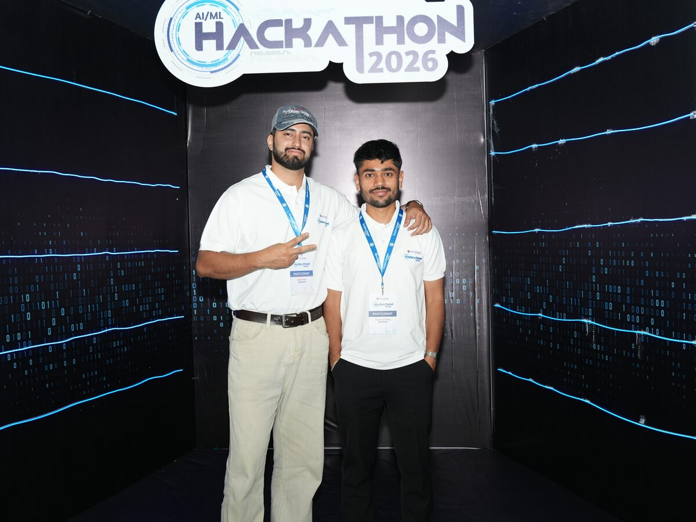
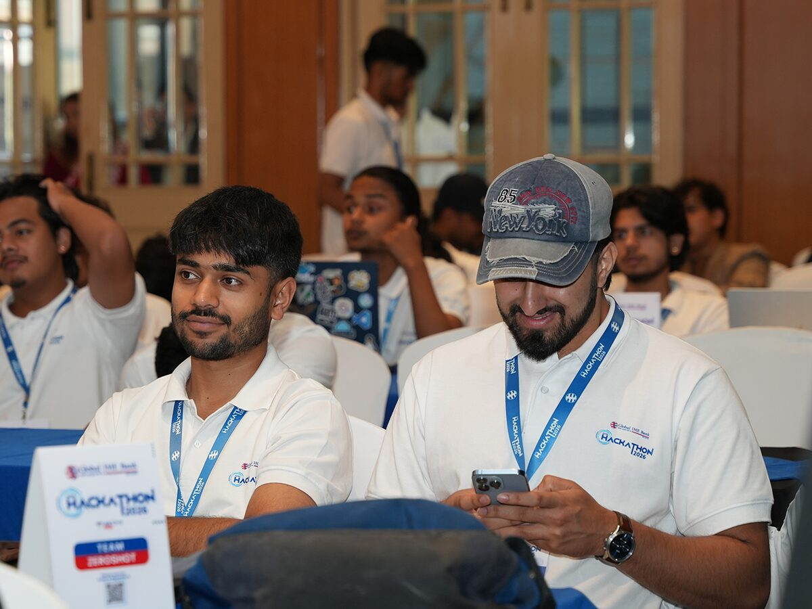
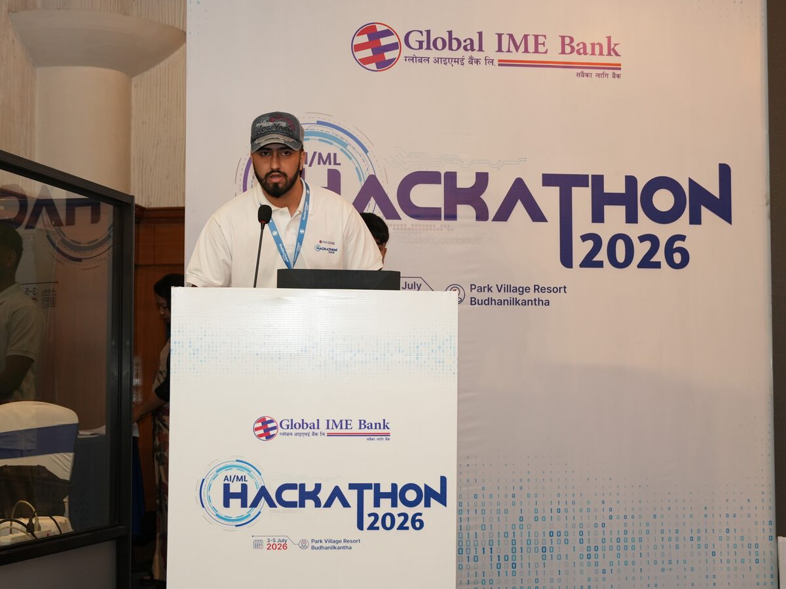
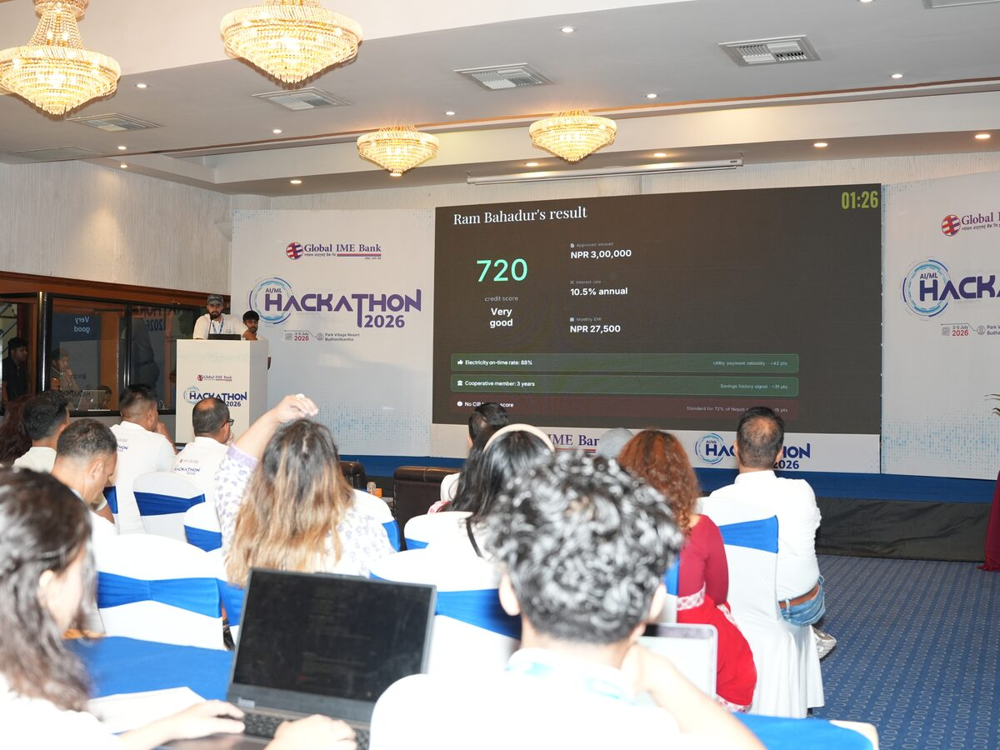
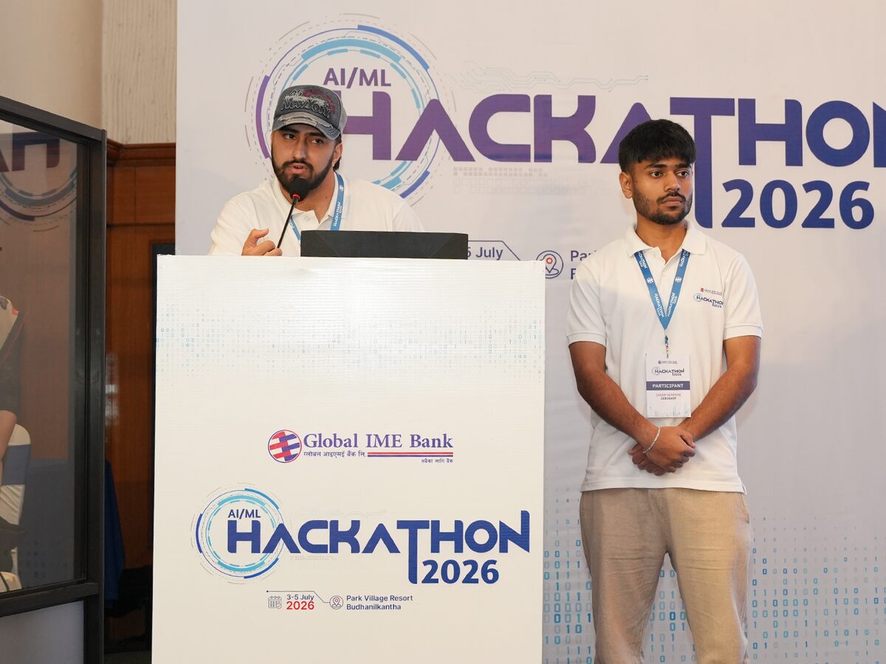
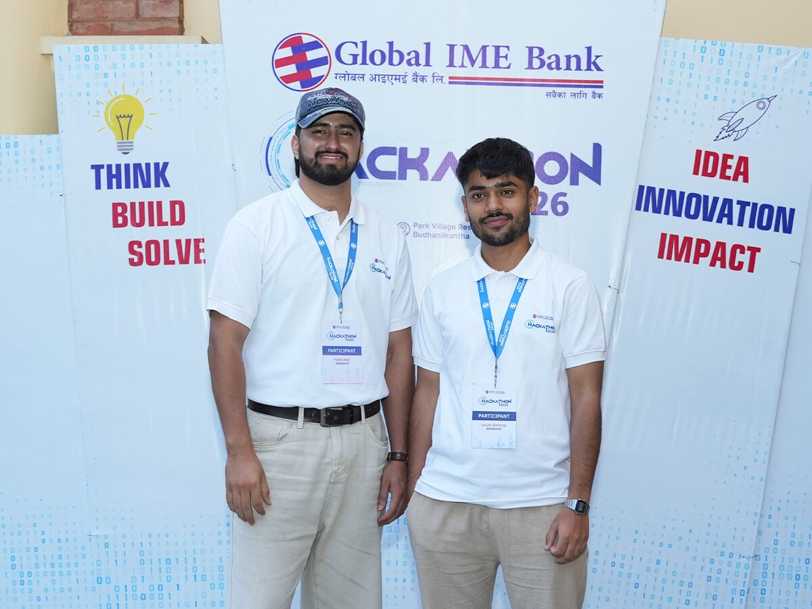
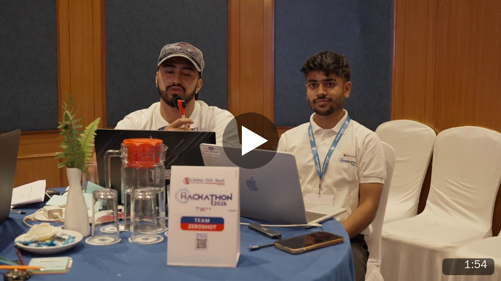

<p align="center">
  
</p>

<h1 align="center">Dhago <sub>धागो</sub></h1>

<p align="center">
  <b>Most informal workers in Nepal have no payslip. They do have records.</b><br>
  Dhago reads those records, checks them against the income an applicant declares, applies written lending rules and gives a loan officer a recommendation with its reasons and a tamper-evident audit trail.
</p>

<p align="center">
  
  <a href="LICENSE"></a>
  <a href="https://www.python.org/downloads/"></a>
  
  
  <a href="#known-issues-and-limitations"></a>
</p>

<p align="center">
  <a href="https://dhago-credit-web.vercel.app"><b>Live demo</b></a> ·
  <a href="https://dhago-credit-api.vercel.app/docs">API documentation</a> ·
  <a href="https://github.com/sagarnewpane/autonomous-credit-and-lending-orchestrator">Source</a>
</p>

<p align="center">
  <a href="#see-it-work">See it work</a> ·
  <a href="#introduction">How it works</a> ·
  <a href="#results-at-a-glance">Results</a> ·
  <a href="#from-the-hackathon">From the hackathon</a> ·
  <a href="#installation">Install</a> ·
  <a href="#reproduce-the-paper">Reproduce the paper</a>
</p>

Dhago (धागो, "thread") is a research prototype for lending to informal-sector borrowers in Nepal: farmers, traders and remittance-receiving households who have no payslip or credit history. It began as team ZeroShot's entry to the GIBL AI/ML Hackathon 2026, where it was one of 16 teams selected for the onsite round, and was then rebuilt for a research paper. It is evaluated on the organisers' synthetic Track A data. It is not a production lending system and has not been used to make real credit decisions.

**What makes it different**

* **It reads the records people already have.** Wallet transactions, remittances through transfer companies, cooperative sales and utility bills become a monthly income with a confidence score.
* **It checks the declared income.** When an applicant's declared income is far from what the records show, the case goes to an officer. The thresholds were studied in simulation before they were set.
* **The rules are written down.** Every lending rule lives in one YAML file with its source, and the file's hash is stamped on every decision.
* **The model never declines on its own.** Only a written veto rule declines; a thin file goes to an officer instead of being rejected, with an affordable counter-offer when the amount is too high.
* **Every step is on the record.** Each stage appends to a hash-chained audit log, so an edit to a past decision shows.
* **Every number in the paper is reproducible.** One command reruns all five experiments, and a second run from scratch gave byte-identical results. 41 automated tests.

## Table of contents

* [See it work](#see-it-work)
* [Introduction](#introduction)
* [Results at a glance](#results-at-a-glance)
* [From the hackathon](#from-the-hackathon)
* [Installation](#installation)
* [Usage](#usage)
* [Implementation status](#implementation-status)
* [Known issues and limitations](#known-issues-and-limitations)
* [Getting help](#getting-help)
* [Contributing](#contributing)
* [License](#license)
* [Authors and history](#authors-and-history)
* [Citing](#citing)
* [Acknowledgments](#acknowledgments)

<!-- public-only:start -->
## See it work

<p align="center">
  
</p>

The [`showcase/`](showcase/) folder is a one-page site that follows four invented applicants through the real pipeline: a remittance household that is approved, a market trader whose file is too thin to decide on, a driver who declares four times what his records show, and a farmer whose application a veto rule declines before the model runs. The audit panel lets you edit the log and watch your browser's SHA-256 check catch it.

```bash
cd showcase && python -m http.server 8000     # then open http://localhost:8000
```

It is static HTML, CSS and JavaScript with no build step, so it deploys on Vercel as it is (see [`showcase/README.md`](showcase/README.md)). Its numbers are produced by the pipeline itself: [`scripts/make_showcase_examples.py`](scripts/make_showcase_examples.py) runs the four invented applicants through the graph and keeps the outputs and the raw audit lines.

One of those applicants, as the loan officer receives it:

```text
Applicant      driver, declares NPR 85,000 a month, asks for NPR 450,000 over 36 months
Records        180 wallet transactions and 6 utility bills, January to June 2024
Income         observed NPR 20,136 a month, confidence 0.65, declared/observed = 4.22
Rules          DSTI_CAP refers (instalment 76.4% of income, cap 50%)
               INCOME_MISMATCH refers (4.22 is outside 0.3 to 3)
Risk           PD 6.3%, grade E, score 565
Recommendation refer to a loan officer
Counter-offer  up to NPR 294,000 over 36 months (instalment NPR 10,068)
Audit          4 entries, chain intact; policy f985d9bccc91, model 827ac57377b5
```
<!-- public-only:end -->

## Introduction

Banks ask for documents that most informal workers cannot produce. Their income is often visible elsewhere: mobile-wallet transfers, remittances from abroad, sales through a cooperative, utility bills paid on time. Dhago reconstructs a monthly income from those records, compares it with what the applicant declares, and keeps every lending rule outside the model, where a compliance officer can read and change it.



| Agent | What it does |
| --- | --- |
| **Income Agent** | Builds a monthly income from remittances, wallet top-ups and cooperative sales, with a confidence score, using only cleaning rules a lender could apply. When the applicant declares an income, computes the income mismatch ratio IMR = declared / observed. |
| **Compliance Agent** | Applies the rules in [`config/policy_rules.yaml`](config/policy_rules.yaml). Each rule has an action (veto, refer or flag) and a provenance label that says where it comes from. |
| **Score Agent** | Estimates the probability of default (PD) with a monotone gradient-boosted model trained on repayment outcomes, and lists the main drivers with SHAP values. Gender, marital status, age and location are not inputs. |
| **Decision Agent** | Recommends approve, conditional, refer or decline. Only a veto rule can decline; the model alone never does. A thin file (low income confidence) is referred to an officer instead of being rejected. When the instalment is unaffordable it proposes the largest affordable amount. |

Every step is written to an append-only log in which each entry carries the hash of the one before, so an edit is detectable (see [Verify the audit log](#verify-the-audit-log) for what a hash chain does not catch). Each decision records the hash of the policy file and of the model that produced it.

## Results at a glance

All results are on the synthetic Track A data and come from `experiments/run_all.py`; the paper gives the details and confidence intervals.

| Question | Finding |
| --- | --- |
| Is the dataset's decision label a credit outcome? | No. A 22-leaf decision tree rebuilds it from four of the dataset's own fields with 99.99% accuracy (E1), so the model is trained on repayment outcomes instead. |
| How well does the released model rank repayment outcomes? | AUC 0.639 [0.608, 0.669] on 9,747 held-out loans with 285 defaults, close to logistic regression (0.634). Mean predicted PD is 2.79% against 2.92% observed (E2). |
| What do the income records add? | Removing the 14 Income-stage features and the 4 profile flags together lowers AUC by 0.054 [0.021, 0.093] (E2). |
| Would protected attributes help? | No. Adding gender, marital status, province, location type and age changes AUC by +0.003 [−0.003, 0.008] (E2); they stay out. |
| How often does the declared-income check flag honest applicants? | Never when all income is visible; 17% overall, and 62% of other informal workers, when much of it is not (E3). The check is a prompt for an officer, not a verdict. |
| What does the policy do to applications? | 77.0% of held-out applicants go to an officer, mostly because the 50% debt-service cap fires for 59.1% of them. 0.5% are declined, all by the blacklist veto (E4). |
| Does the running graph match the batch computation? | 300 of 300 recommendations match, the largest PD difference is 5×10⁻⁶, and all 1,203 audit entries verify. Median time is 181 ms per application on two CPU cores (E5). |

<!-- public-only:start -->
## From the hackathon

Dhago started at the **GIBL AI/ML Hackathon 2026**, organised by Global IME Bank. Team ZeroShot was one of 16 teams selected for the onsite round, held from 3 to 5 July 2026 at Park Village Resort, Budhanilkantha, where the organisers handed the teams the Track A dataset and the build began.

<table>
  <tr>
    <td width="33%"><br><sub>Team ZeroShot at the onsite round</sub></td>
    <td width="33%"><br><sub>Building at the team table</sub></td>
    <td width="33%"><br><sub>Pitching at the onsite round</sub></td>
  </tr>
  <tr>
    <td width="33%"><br><sub>The hackathon-day demo on the main screen</sub></td>
    <td width="33%"><br><sub>On stage together</sub></td>
    <td width="33%"><br><sub>Think, build, solve</sub></td>
  </tr>
</table>

<p align="center">
  <a href="docs/media/team-at-the-onsite-round.mp4"></a><br>
  <sub>The team at the onsite round (video, 1 min 54 s)</sub>
</p>

**From the hackathon build to version 0.2.0.** The weekend version worked on stage but had bugs that only showed under a full evaluation. The rebuild fixed 16 of them, listed in [CHANGES.md](CHANGES.md): the credit score rose with the model's confidence in a rejection, a field-name mismatch dropped every remittance date, and the model configuration listed 64 features for a 60-feature model, so every score fell back to 300. It also moved every lending rule into a versioned policy file, added the hash-chained audit log, retrained the model on repayment outcomes instead of the dataset's own decision label, and added the experiments, tests and this showcase. The slides and documentation submitted at the hackathon are in [`docs/hackathon-2026/`](docs/hackathon-2026/).
<!-- public-only:end -->

## Installation

Requirements: Python 3.13, about 2 GB of memory for the pipeline and about 4 GB for the full experiments. PostgreSQL and Ollama are not needed for anything in this README.

```bash
git clone https://github.com/sagarnewpane/autonomous-credit-and-lending-orchestrator.git dhago
cd dhago
python3.13 -m venv .venv
source .venv/bin/activate
pip install -r requirements.txt          # pipeline, API and experiments (pinned versions)
pip install -r requirements-dev.txt      # tests and figures
pip install -r requirements-ocr.txt      # optional: the Document Agent prototype
```

### Data

The experiments use the GIBL AI/ML Hackathon 2026 Track A dataset: synthetic records for 100,000 applicants, provided by Global IME Bank to hackathon participants. The data are **not** included in this repository and may not be redistributed. To reproduce the results, obtain them from the organisers and point `TRACK_A_DIR` at the `structured` folder:

```text
Track A/structured/
├── applicant_profiles.csv        ├── loan_applications.csv
├── cooperative_members.csv       ├── loan_outcomes.csv
├── cooperative_sales.csv         ├── mobile_money_transactions.parquet
├── credit_score_components.csv   ├── remittance_records.parquet
├── income_signal_features.csv    └── utility_payments.parquet
```

The tests and the API run without the data. The API defaults to SQLite and seeds two demo accounts on first start:

| Role | Email | Password |
| --- | --- | --- |
| Applicant | `demo@dhago.app` | `Demo@2026` |
| Admin | `admin@dhago.app` | `Admin@2026` |

Set `SEED_DEMO_USERS=0` to disable them, or override the credentials with `DEMO_USER_EMAIL`, `DEMO_USER_PASSWORD`, `DEMO_ADMIN_EMAIL` and `DEMO_ADMIN_PASSWORD`. The login pages are pre-filled with these accounts.

## Usage

### Quick start: score applications offline

```bash
export TRACK_A_DIR="/path/to/Track A/structured"
python scripts/run_offline.py --n 5
```

The data are read into memory (`DATA_BACKEND=files`), each application goes through the four agents, and the audit chain is checked at the end:

```text
LA-2081-000028  approve      PD=0.017  score=604  rules=-  conf=0.71  5841 ms
LA-2081-000077  refer        PD=0.06295  score=565  rules=KYC_TIER_LIMIT,AGRI_LOAN_TO_INCOME,DSTI_CAP  conf=0.45  334 ms
LA-2081-000108  refer        PD=0.06738  score=563  rules=AGRI_LOAN_TO_INCOME,DSTI_CAP  conf=0.51  270 ms
LA-2081-000145  refer        PD=0.04225  score=577  rules=DSTI_CAP  conf=0.55  298 ms
LA-2081-000156  refer        PD=0.04692  score=574  rules=DSTI_CAP  conf=0.45  295 ms

5 applications in 7.0s; audit log audit_log.jsonl: 20 entries, chain OK
```

The full output for each application (reasons, triggered rules with their traces, SHAP drivers, policy and model versions) is written to `offline_run.jsonl`. Track A has no declared income, so pass one to see the IMR check:

```bash
python scripts/run_offline.py --application-id LA-2081-000028 --declared-income 25000
```

### Reproduce the paper

```bash
python experiments/run_all.py --data "$TRACK_A_DIR"
```

This takes about 15 minutes on two CPU cores, 11 of them for the income features of all 100,000 applicants (add `--skip-features` to reuse them). Seeds are fixed: a rerun from scratch on the same machine reproduced identical features, results and a byte-identical model file; only the E5 timings and the audit log's timestamps (and so its head hash) vary.

| Script | Question | Output |
| --- | --- | --- |
| `data_summary.py` | Table sizes, splits, labels and outcomes (Section IV-A) | `results/data_summary.json` |
| `build_features.py` | Income Agent features for every applicant | `cache/income_features.parquet` (not committed) |
| `e1_label_circularity.py` | Can the Track A decision label be learned as a credit outcome? | `results/e1_label_circularity.json` |
| `e2_outcome_model.py` | How well does PD rank repayment outcomes, and what do the income features add? | `results/e2_outcome_model.json`, `figures/e2_roc_calibration.pdf`, the deployed model |
| `e3_imr_simulation.py` | How often does the IMR check flag honest applicants when part of their income is not visible? | `results/e3_imr_simulation.json`, `figures/e3_imr_tradeoff.pdf` |
| `e4_routing_fairness.py` | What does the policy do to the decision mix, thin files and subgroups? | `results/e4_routing_fairness.json` |
| `e5_pipeline_run.py` | Does the graph reproduce the batch decisions, and is the audit chain intact? | `results/e5_pipeline_run.json` |

All paths are under `experiments/`. `results/summary.json` collects the numbers quoted in the paper.

### Run the tests

```bash
pytest
```

41 tests cover the policy engine, regressions for the bugs listed in [CHANGES.md](CHANGES.md), the decision rules, audit tamper detection, the in-memory backend, the model and an API smoke test. The end-to-end test runs only when `TRACK_A_DIR` is set.

### Run the API

```bash
export DATA_BACKEND=sqlite SQLITE_PATH=data/dhago.db
export JWT_SECRET_KEY="$(python -c 'import secrets; print(secrets.token_hex(32))')"
uvicorn app.main:app --port 8000
```

The SQLite database and the demo accounts are created automatically on first start. Use `DATA_BACKEND=files` to keep the previous in-memory Track A mode.

Interactive documentation is at `http://localhost:8000/docs`. The main endpoints:

| Endpoint | Purpose |
| --- | --- |
| `POST /api/v1/auth/signup`, `POST /api/v1/auth/login` | Create an account and get a bearer token |
| `POST /api/v1/loan/apply` | Submit an application; returns the recommendation, PD, grade, reasons, triggered rules and drivers |
| `GET /api/v1/loan/decision/{application_id}` | Read a stored recommendation |
| `GET /api/v1/loan/compliance/references/{application_id}` | Rule traces for an application |
| `GET /api/v1/admin/audit/{application_id}` | Audit-log entries and a chain check (admin only) |

[`tests/test_api_offline.py`](tests/test_api_offline.py) shows a complete sign-up, application and decision round trip. In SQLite mode, users and applications persist in the file named by `SQLITE_PATH`; on Vercel that file is `/tmp/dhago.db`, which is writable but per-instance and ephemeral. In files mode, data written through the API are kept in memory only. A new applicant has no transaction records and no screening result, so the API refers every application it receives in either mode.

The officer dashboard is a SvelteKit app. It builds and type-checks, but has not been tested in a browser for this release:

```bash
cd frontend && cp .env.example .env && npm ci && npm run dev
```

### Change the lending policy

Rules live in [`config/policy_rules.yaml`](config/policy_rules.yaml), not in code. For example, the affordability rule:

```yaml
- id: DSTI_CAP
  description: Monthly debt service, including the new instalment, exceeds 50% of observed monthly income.
  check: dsti_above
  params:
    max_ratio: 0.50
  action: refer                    # veto | refer | flag
  provenance: regulator_reported   # hackathon_rule | hackathon_field | regulator_reported | design
  source_status: secondary
```

Edit a threshold or an action and rerun; the new `policy_version` (a hash of the file) appears in every decision and audit entry made under it. Supported checks are listed in [`app/services/policy_engine.py`](app/services/policy_engine.py).

### Verify the audit log

```python
from app.services import audit
audit.verify()   # {'ok': True, 'entries': 20, 'first_bad_seq': None, 'head': '3f9c...'}
```

Editing an entry makes `verify()` report its sequence number, unless every later entry is rewritten as well. Deleting entries from the end leaves a valid, shorter chain. To detect both, store `head` somewhere the log's writer cannot change and compare it later.

## Implementation status

| Component | Status | Evidence |
| --- | --- | --- |
| Income Agent | Implemented | `tests/test_income_agent.py`, E5 |
| Compliance Agent and policy file | Implemented | `tests/test_policy_engine.py` |
| Score Agent (PD model) | Implemented; trained on synthetic outcomes only | E2 |
| Decision Agent and counter-offer | Implemented | `tests/test_decision_agent.py` |
| Hash-chained audit log | Implemented | `tests/test_audit.py`, E5 |
| SQLite data backend | Implemented; default for the API, seeded demo logins | `app/db/sqlite.py`, `tests/test_sqlite_backend.py` |
| Offline data backend | Implemented; in-memory Track A CSVs | `tests/test_memory_backend.py` |
| REST API | Implemented; tested in files and SQLite modes | `tests/test_api_offline.py`, `tests/test_sqlite_backend.py` |
| Showcase site | Static walkthrough on invented applicants; checked in Chromium at desktop and phone widths | `showcase/` |
| Document Agent (OCR of citizenship, land and tax documents) | Prototype; not part of the pipeline and not evaluated | `app/agents/parser_agent.py` |
| PostgreSQL deployment | From the hackathon; schema and loaders not included, not retested | `app/db/postgres.py` |
| Officer dashboard (SvelteKit) | Updated to show real values; builds and type-checks, not tested in a browser | `frontend/` |
| Explanations in Nepali | Not implemented | |
| AML, sanctions and PEP screening; Credit Information Bureau lookup | Not implemented; Track A supplies simulated flags | |

## Known issues and limitations

* **Synthetic data.** Every result comes from the Track A generator. Repayment outcomes exist only for loans the generator approved, so the PD model has not seen the applicants it would refer or decline. Nothing here shows how the system would perform on real borrowers.
* **The records post-date the applications.** Applications in Track A are dated October 2022 to April 2024, but the wallet, remittance and utility records cover January to June 2024, after most applications and after many defaults. The evaluation is therefore not point-in-time; E2 reports how the results depend on when each default happened.
* **The rules are not Nepal Rastra Bank clauses.** Three rules reproduce the simulated policy in the Track A data manual, even where it uses "NRB-" codes; two use simulated screening flags supplied with the data; and the three-loan limit is our reading of a manual rule that gives no threshold. The 50% debt-service cap is modelled on a press report of an NRB rule for personal, home and hire-purchase loans, and is applied here to every loan type. Track A has no existing repayments, so the cap counts only the new instalment. Check each rule against the current Unified Directive before any real use.
* **No anomaly detection.** Cleaning uses only rules a lender could apply (repeated rows, implausible exchange rates, formatting, future dates), not the generator's noise labels. Wallet transactions that the generator marked as fraud patterns are kept as ordinary transactions.
* **Wallet top-ups count as income.** The data manual treats them as an income proxy, but they can include the applicant's own savings; they form a separate source with a lower prior confidence.
* **Observed income understates true income.** Income paid in cash is invisible to the Income Agent. Half of the held-out Track A applicants have less than NPR 3,691 a month of observed income, so the debt-service rule refers most applications (it fires for 59% of them). The IMR check flags honest applicants more often when less of their income is visible: in simulation, from 0% when all income is visible to 17% overall (62% of other informal workers) when much of it is not.
* **No OCR evaluation.** Document reading is a prototype outside the pipeline; no accuracy is claimed.
* **PostgreSQL mode** needs a schema and loaders that are not in the repository; the scripts in `scripts/legacy/` that did this were already broken. Use files mode.
* **Security.** Authentication is a development setup. Set `JWT_SECRET_KEY`; tokens are revoked in memory only.
* **Hackathon materials** in `docs/hackathon-2026/` describe the earlier design and contain figures that the current code does not reproduce; see [CHANGES.md](CHANGES.md).

## Getting help

Open an issue on [GitHub](https://github.com/sagarnewpane/autonomous-credit-and-lending-orchestrator/issues). Please include the command you ran, the full error and your Python version.

## Contributing

Issues and pull requests are welcome. Please run `pytest` before opening a pull request, and keep lending rules in the policy file with a `provenance` and `source` for each.

## License

The code is released under the [MIT License](LICENSE). The Track A data are not covered by this license and are not distributed here. The showcase fonts (Anek, by Ek Type) are under the SIL Open Font License; see [`showcase/fonts/OFL.txt`](showcase/fonts/OFL.txt). The structure of this README follows [READMINE](https://github.com/mhucka/readmine) (CC0).

## Authors and history

Pujan Pant and Sagar Newpane. The project began as team ZeroShot's entry to the GIBL AI/ML Hackathon 2026, organised by Global IME Bank; the team was one of 16 selected for the onsite round (3–5 July 2026, Park Village Resort, Budhanilkantha). The organisers provided the Track A data to participants. Version 0.2.0 is the version described in the paper; [CHANGES.md](CHANGES.md) lists what changed since the hackathon, including the bugs fixed. The hackathon materials are kept in [`docs/hackathon-2026/`](docs/hackathon-2026/) and the event photos and video in [`docs/media/`](docs/media/).

## Citing

If you use this software, please cite it using [CITATION.cff](CITATION.cff):

```bibtex
@software{dhago2026,
  author  = {Pant, Pujan and Newpane, Sagar},
  title   = {Dhago: a compliance-first credit assessment pipeline for informal borrowers in Nepal},
  year    = {2026},
  version = {0.2.0},
  url     = {https://github.com/sagarnewpane/autonomous-credit-and-lending-orchestrator}
}
```

## Acknowledgments

We thank Global IME Bank for organising the hackathon and providing the Track A data. Parts of version 0.2.0 (refactoring, tests, experiment scripts and the showcase site) were drafted with an AI coding assistant (Anthropic's Claude) and checked by the authors.
